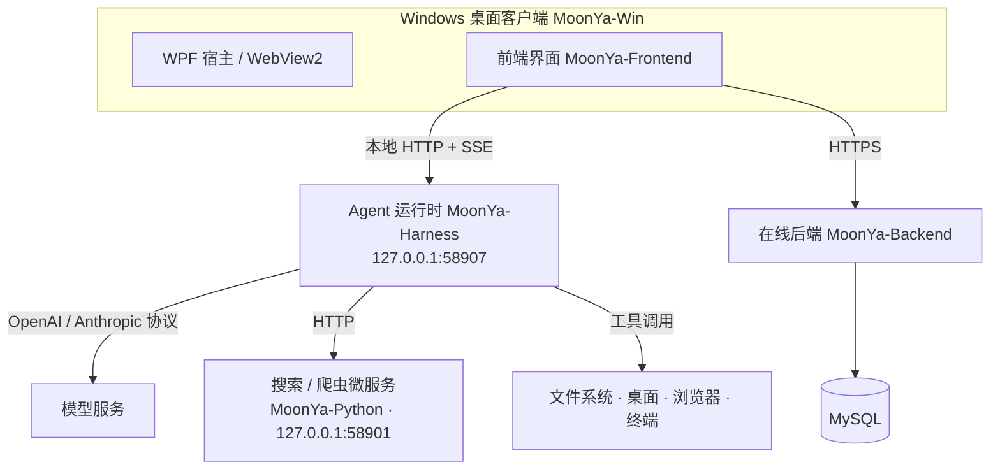

# MoonYa

**本地优先的 AI 桌面助手 / Agent 平台。**

MoonYa 把「聊天」和「真正在电脑上干活」放进同一个界面：Windows 客户端承载前端，本地 Agent 运行时驱动模型循环、工具调用、文件改写、桌面操作与浏览器自动化；在线能力（账号、会员、支付、附件、模型代理）由独立的 PHP 后端提供。

> Apache-2.0 开源。仓库内不含任何真实密钥、数据库口令或用户数据，全部通过环境变量注入。


## 核心能力

- **双模式对话** —— `Chat` 走轻量对话；`Work` 进入项目工作区，允许读写文件、跑命令、改代码。
- **子代理办公室** —— 一个任务可拆给多个子代理并行执行，带工位视图、父子层级、整体取消与重连恢复。
- **Computer Use** —— 通过 UIA 树 + 视觉定位操作真实桌面窗口（点击、输入、截图、登录识别）。
- **浏览器自动化** —— 内置面板直接导航；也可接 Chrome / Edge，使用独立自动化窗口。
- **工作区变更与撤销** —— 每轮记录原始字节快照，支持整文件级回滚，非 Git 目录同样可用。
- **三种权限模式** —— 请求批准 / 帮我批准 / 完全访问，逐聊天独立保存。
- **可重连会话** —— 事件按序号持久化，流式输出断线后从上一个事件续订，不重复请求上游。
- **自定义模型供应商** —— 支持 OpenAI Chat Completions 与 Anthropic Messages 协议，配置落在本机 `config.toml`。
- **技能系统** —— 服务端下发技能目录，运行时按需读取正文，可逐项启用。

## 架构



桌面上所有「执行」都在本机完成，后端只负责账号、计费、模型代理与附件等在线部分 —— 断网时 Chat 仍可用，Work 的本地工具也不依赖服务端。

## 组成

| 目录 | 技术栈 | 职责 |
| --- | --- | --- |
| `MoonYa-Win/` | .NET 8 / WPF | 桌面宿主：窗口、WebView2 承载、桌面 / 文件 / 执行服务、更新安装；含 14 个冒烟与视觉回归工程 |
| `MoonYa-Frontend/` | 原生 JS / ES Modules | 聊天与设置界面，`build.mjs` 打包到 `dist/` |
| `MoonYa-Harness/` | Node.js ≥ 22.19 / ESM | 本地 Agent 运行时：会话事件、SSE、模型循环、工具协议、子代理、工作区撤销 |
| `MoonYa-Backend/` | PHP 8.1+ / MySQL / PDO | 账号、会员、支付、模型代理、附件、管理端 |
| `MoonYa-Python/` | Python 3 | 网页搜索与正文抓取微服务（`web_search` / `web_crawler`） |

## 目录结构

```
MoonYa/
├── MoonYa-Win/
│   └── MoonYa-Solution/
│       ├── MoonYa/                 # 客户端主工程（net8.0-windows10.0.19041.0）
│       ├── MoonYa.DesktopHost/     # 桌面能力宿主
│       ├── MoonYa.VirtualDisplay/  # 虚拟显示器（可选，基于 MS-PL 示例驱动）
│       └── MoonYa.*Smoke/          # 各类冒烟与视觉回归工程
├── MoonYa-Frontend/
│   ├── src/                        # 界面源码，加载顺序由 manifest.json 决定
│   ├── public/                     # 静态资源与固定版本第三方库
│   ├── build.mjs                   # 构建脚本，输出 dist/
│   └── tests/
├── MoonYa-Harness/
│   ├── src/                        # 运行时主体（入口 server.mjs）
│   ├── foundation/                 # DeepSeek Harness 上游副本（MIT）
│   ├── scripts/                    # 子代理运行时构建与校验
│   └── tests/
├── MoonYa-Backend/
│   ├── api.php                     # 聊天主接口
│   ├── harness_api.php             # 桌面网关：会话 / 权限 / 模型配置
│   ├── SQL/                        # 表结构、迁移与开源数据库快照
│   ├── Services/                   # 鉴权、支付、邮件等业务服务
│   ├── admin/                      # 管理端
│   └── deployment/                 # Apache 配置
├── MoonYa-Python/                  # 搜索 / 爬虫微服务（main.py）
├── docs/                           # 跨模块技术说明
└── tools/                          # 构建与打包脚本
```

## 快速开始

### 环境要求

| 组件 | 版本 |
| --- | --- |
| Windows | 10 / 11（客户端运行必需） |
| .NET SDK | 8.0 |
| Node.js | ≥ 22.19 |
| PHP | 8.1+，扩展 `openssl` `pdo` `pdo_mysql` `mbstring` `gd` |
| MySQL | 8.0+ |
| Python | 3.9+（仅搜索/爬虫微服务） |

### 1. 数据库

```bash
mysql -u root -p -e "CREATE DATABASE ai_system DEFAULT CHARACTER SET utf8mb4 COLLATE utf8mb4_unicode_ci;"
mysql -u root -p ai_system < MoonYa-Backend/SQL/ai_system_opensource.sql
```

这份快照包含 **34 张表**的完整结构，其中 7 张带系统配置数据（系统提示词、内置模型、会员套餐、应用注册表、界面文案等），**其余 27 张只有结构、没有任何用户数据**。

`builtin_models.api_key` 已替换为 `sk-REDACTED`，导入后需填入自己的密钥，或改成 `@env:DEEPSEEK_API_KEY` 由后端从环境变量读取。

### 2. 在线后端

```bash
cd MoonYa-Backend
composer install
cp .env.example .env        # 或 .env.server.example（服务器部署）
```

`.env` 至少需要填：`DB_HOST` `DB_NAME` `DB_USER` `DB_PASS` `JWT_SECRET` `ADMIN_SECRET`，以及要用的模型厂商 Key。然后把站点根目录指向 `MoonYa-Backend/`（Apache 参考 `deployment/apache.conf`），或本地开发：

```bash
php -S 127.0.0.1:8080 -t .
```

仓库同时提供 `MoonYa-Backend/Dockerfile`（`php:8.2-apache` + gd/zip/mbstring + ffmpeg/poppler），适合打包线上镜像。

### 3. Agent 运行时

```bash
cd MoonYa-Harness
npm ci
npm run build:subagents     # 校验并组合 34 个子代理源码文件
npm test
npm start                   # 127.0.0.1:58907
```

运行数据存放在 `%USERPROFILE%\.MoonYa\agent-runtime`，自定义供应商配置在同目录的 `config.toml`。

### 4. 前端

```bash
cd MoonYa-Frontend
npm ci
npm run build               # 输出 dist/
```

`manifest.json` 决定脚本加载顺序，新增文件必须登记。**不要用 `file://` 直接打开页面**，客户端通过本地 HTTP 服务提供 `/index.html` 与资源。

### 5. 搜索 / 爬虫微服务

```bash
cd MoonYa-Python
pip install -r requirements.txt
playwright install chromium  # 抓取需要浏览器内核
python main.py               # 127.0.0.1:58901
```

搜索源与超时、结果条数等配置见 `service_config.json`，默认 DuckDuckGo 主源 + 百度 / 必应回退。

### 6. 桌面客户端

```bash
dotnet build MoonYa-Win/MoonYa-Solution/MoonYa/MoonYa.csproj -c Debug
```

修改 Harness 源码后必须重新构建并重启客户端 —— 已启动的 Node 进程不会热更新。

## 开发与测试

```bash
# 运行时
node --test MoonYa-Harness/tests/*.test.mjs

# 前端（构建 + FrontendSmoke + 浏览器回归）
npm test --prefix MoonYa-Frontend

# 后端：tests/ 下是自带断言的独立 PHP 脚本，逐个执行，失败即抛异常
for f in MoonYa-Backend/tests/*_test.php; do php "$f" || break; done

# 桌面端冒烟
dotnet run --project MoonYa-Win/MoonYa-Solution/MoonYa.ThemeSmoke -- .
```

各模块的协议细节、数据布局与验收入口见其内部 `docs/`。

## 配置

仓库只提供模板，**不要把真实密钥写进代码**：

- `MoonYa-Backend/.env.example` → 本地 / 桌面场景
- `MoonYa-Backend/.env.server.example` → 服务器部署
- 模型 Key、数据库口令、`JWT_SECRET`、`ADMIN_SECRET`、SMTP、支付证书材料全部走环境变量
- 支付主密钥放在站点同级的独立目录（如 `/www/wwwroot/moonya-payment-keys`），不要放进仓库

`.gitignore` 已排除 `.env*`、证书与密钥材料、本地数据库 dump、构建产物与备份目录。

## 安全模型

- 三种权限模式是**应用层**检查：请求批准（项目内常规读写）、帮我批准（由独立无工具审核请求决定）、完全访问（跳过确认）。
- **不提供操作系统级沙箱**，不能限制任意命令及其子进程的全部文件与网络访问；不要用它运行不可信代码。
- 路径检查会统一规范化相对路径、Windows 大小写、目录穿越与符号链接。
- 第三方凭据仅从环境变量或安全存储读取，仓库内不含任何真实值。

## 已知限制

- 客户端仅支持 Windows 10/11；跨平台需自行适配桌面能力层。
- 运行时只接受本机回环请求，并拒绝带浏览器 `Origin` 的直接访问，Web 界面统一经已登录的 PHP 适配层转发。
- 旧版本（非 `.MoonYa` 数据根）的本地数据需要手动备份迁移，源码不含自动迁移逻辑。

## 第三方组件

Highlight.js（BSD-3-Clause）、Mammoth.js（BSD-2-Clause）、PDF.js（Apache-2.0）、jsdiff（BSD-3-Clause）、node-ignore（MIT）、Koffi（MIT）、DeepSeek Harness（MIT）、Microsoft Windows-driver-samples（MS-PL）。

完整归属与许可文本见 [`THIRD_PARTY_NOTICES.md`](./THIRD_PARTY_NOTICES.md) 及各上游目录内的许可声明。

## 许可证

[Apache License 2.0](./LICENSE)
